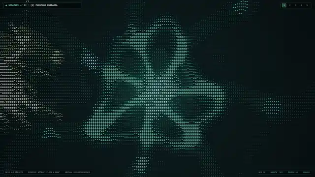

# SOMATYPE // 01 — Interactive ASCII Cell Organism

An original, self-contained full-viewport ASCII organism rendered on HTML5 Canvas 2D with zero external dependencies or frameworks.

**Live demo:** https://artem-kaseka.github.io/ascii-cell-organism/  
**Full 1080p60 video (with procedural audio):** [`ascii-cell-organism-1080p60.mp4`](https://github.com/artem-kaseka/ascii-cell-organism/releases/download/v1.0.0/ascii-cell-organism-1080p60.mp4)

[](https://github.com/artem-kaseka/ascii-cell-organism/releases/download/v1.0.0/ascii-cell-organism-1080p60.mp4)

*(Click the preview above to watch or download the full 15s 1920×1080 60fps H.264 + 48 kHz stereo MP4.)*

## Architecture

Every cell `(x, y)` on the monospace grid (`160×60` at `1920×1080`) is evaluated through a shader-like function in [`organism.js`](./organism.js):

```js
main(x, y, t, pointer) -> { glyph, color }
```

Five living systems are composited into a single bioluminescent typographic organism:

- **Breathing** — Asymmetric inhale/exhale cycle modulating mantle scale, tissue density, tendril reach, and phosphor luminance.
- **Traveling Wavefronts** — Radial peristaltic and diagonal cross-current interference waves rippling across the membrane and tentacles.
- **Decaying Trails** — Diffusing, exponentially decaying wake grid energized by pointer sweeps and symbiotic flock wakes.
- **Cursor-Attracted Flock** — 54 autonomous directional zooid agents (`> / ^ \ < v`) steering toward and orbiting the pointer while leaving typographic wakes.
- **Heartbeat Glyph Field** — A double-pulse (`lub-dub`) rhythmic core organ radiating concentric systolic shockwave rings across the full viewport.

## Running Live

Open [`index.html`](./index.html) directly in any modern browser (or serve this directory with `python3 -m http.server`).

### Controls

- **Pointer** — Attract and orbit the flock, carve decaying wakes, and locally warp the organism's membrane.
- **Keys `1`–`5`** (or click the top-right HUD pills) — Switch between 5 original dark-terminal presets:
  1. `[1] PHOSPHOR CNIDARIA` — Abyssal emerald-teal mantle with lime-cyan flock wakes.
  2. `[2] AMBER MYCELIUM` — Warm CRT amber-ochre hyphae with luminous mint-cream zooids.
  3. `[3] CARDIAC CORAL` — Emphasized crimson-coral systolic heartbeat with contrasting cyan-silver flock.
  4. `[4] CYAN TIDE-SWARM` — High-frequency electric cyan cross-waves with neon chartreuse darting wakes.
  5. `[5] SPECTRAL X-RAY` — Phosphor-noir skeletal electron-microscope field with selective teal/gold accents.
- **`Space`** — Pause / resume.
- **`D`** — Toggle scripted demo autopilot.
- **`R`** — Reset & re-seed the organism.

## Deterministic 1080p60 Capture

`capture.py` drives `index.html?capture=1` frame-by-frame in headless Chromium (`1920×1080`, `deviceScaleFactor=1`) via `window.__organism.renderFrame(frameIndex)` (seeded PRNG + fixed `1/60s` timestep), pipes PNG frames into `ffmpeg`, and muxes an original procedural 48 kHz stereo soundtrack into `ascii-cell-organism-1080p60.mp4`.
